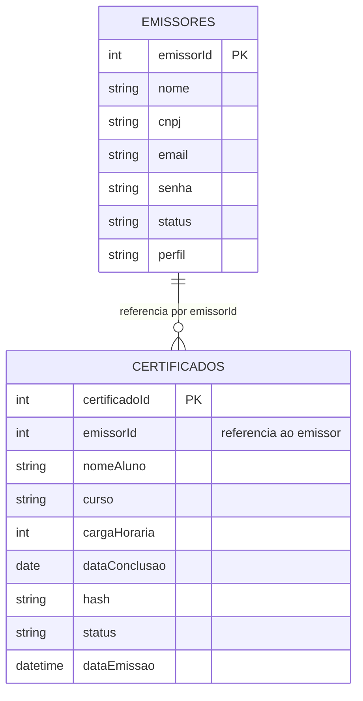

# TIMBRO: AUTENTICAÇÃO DE CERTIFICADOS COM BLOCKCHAIN

**PONTIFÍCIA UNIVERSIDADE CATÓLICA DE CAMPINAS**  
**SISTEMAS DE INFORMAÇÃO**

* **CAIO LUCENA ANDRADE** – RA: 25011275
* **EMELY MIGUEL MOREIRA** – RA: 25896580
* **GABRIEL BIAZON GALEAZZI** – RA: 25004250
* **VIVIANE CONCEIÇÃO COSTA** – RA: 25897398

**Documento de Projeto · Turma 0102 · Grupo 05**

Documento de Projeto apresentado no componente curricular *Projeto Integrador IV*, do curso de Sistemas de Informação, da Pontifícia Universidade Católica de Campinas (Turma 0102 · Grupo 05 · 2026-2).

**CAMPINAS — 2026-2**

---

## SUMÁRIO

* [1 VISÃO GERAL](#1-visão-geral)
  * [1.1 Problema](#11-problema)
  * [1.2 Público](#12-público)
  * [1.3 Escopo da versão](#13-escopo-da-versão)
  * [1.4 Fora do escopo desta versão](#14-fora-do-escopo-desta-versão)
* [2 OBJETIVOS](#2-objetivos)
  * [2.1 Objetivo geral](#21-objetivo-geral)
  * [2.2 Objetivos específicos](#22-objetivos-específicos)
  * [2.3 Critério de sucesso](#23-critério-de-sucesso)
* [3 REQUISITOS](#3-requisitos)
  * [3.1 Requisitos funcionais](#31-requisitos-funcionais)
    * [3.1.1 E1 – Acesso restrito à área do emissor](#311-e1--acesso-restrito-à-área-do-emissor)
    * [3.1.2 E2 – Registro do certificado](#312-e2--registro-do-certificado)
    * [3.1.3 E3 – Validação de certificado](#313-e3--validação-de-certificado)
    * [3.1.4 E4 – Painel de histórico para o emissor](#314-e4--painel-de-histórico-para-o-emissor)
    * [3.1.5 E5 – Cadastro e validação de novos emissores](#315-e5--cadastro-e-validação-de-novos-emissores)
    * [3.1.6 E6 – Revogação de certificados](#316-e6--revogação-de-certificados)
  * [3.2 Requisitos não funcionais](#32-requisitos-não-funcionais)
  * [3.3 Rastreabilidade](#33-rastreabilidade)
* [4 ARQUITETURA](#4-arquitetura)
  * [4.1 Visão da arquitetura](#41-visão-da-arquitetura)
  * [4.2 Implantação com Docker Compose](#42-implantação-com-docker-compose)
  * [4.3 Comunicação por WebSocket](#43-comunicação-por-websocket)
  * [4.4 Eventos WebSocket principais](#44-eventos-websocket-principais)
  * [4.5 Tecnologias](#45-tecnologias)
* [5 BANCO DE DADOS](#5-banco-de-dados)
  * [5.1 Coleção emissores](#51-coleção-emissores)
  * [5.2 Coleção certificados](#52-coleção-certificados)
  * [5.3 Relação e observações](#53-relação-e-observações)
* [6 CONTRATOS E DECISÕES ARQUITETURAIS](#6-contratos-e-decisões-arquiteturais)
  * [6.1 Contratos (CT)](#61-contratos-ct)
  * [6.2 ADRs (registros de decisões arquiteturais)](#62-adrs-registros-de-decisões-arquiteturais)
* [7 TESTES](#7-testes)
  * [7.1 Estratégia](#71-estratégia)
  * [7.2 Inventário estático dos testes automatizados](#72-inventário-estático-dos-testes-automatizados)
  * [7.3 Execução registrada e pendente](#73-execução-registrada-e-pendente)
  * [7.4 Casos de teste (TE)](#74-casos-de-teste-te)
  * [7.5 Defeitos e pendências conhecidos](#75-defeitos-e-pendências-conhecidos)
* [8 PRINCIPAIS TELAS](#8-principais-telas)
  * [8.1 Verificação pública (E3)](#81-verificação-pública-e3)
  * [8.2 Login do emissor e do administrador (E1)](#82-login-do-emissor-e-do-administrador-e1)
  * [8.3 Solicitação de cadastro de emissor (E5)](#83-solicitação-de-cadastro-de-emissor-e5)
  * [8.4 Registro de certificado (E2)](#84-registro-de-certificado-e2)
  * [8.5 Painel de histórico (E4)](#85-painel-de-histórico-e4)
  * [8.6 Revogação (E6)](#86-revogação-e6)
  * [8.7 Administração de emissores (E5)](#87-administração-de-emissores-e5)
* [9 COMO RODAR](#9-como-rodar)
  * [9.1 Identificação do sistema e integrantes](#91-identificação-do-sistema-e-integrantes)
  * [9.2 Repositórios](#92-repositórios)
  * [9.3 Pré-requisitos](#93-pré-requisitos)
  * [9.4 Clonar os três repositórios](#94-clonar-os-três-repositórios)
  * [9.5 Criar as variáveis e subir os serviços](#95-criar-as-variáveis-e-subir-os-serviços)
  * [9.6 Endereços e portas](#96-endereços-e-portas)
  * [9.7 Encerrar os serviços](#97-encerrar-os-serviços)
  * [9.8 Como usar](#98-como-usar)
  * [9.9 Executar os testes por módulo](#99-executar-os-testes-por-módulo)
* [10 CONCLUSÃO](#10-conclusão)
  * [10.1 O que o sistema entrega](#101-o-que-o-sistema-entrega)
  * [10.2 O que deu trabalho e por quê](#102-o-que-deu-trabalho-e-por-quê)
  * [10.3 O que aprendemos](#103-o-que-aprendemos)
  * [10.4 O que ficou diferente do planejado](#104-o-que-ficou-diferente-do-planejado)
  * [10.5 Próximos passos](#105-próximos-passos)
* [11 ANEXOS](#11-anexos)
  * [11.1 Repositórios e artefatos externos](#111-repositórios-e-artefatos-externos)
  * [11.2 Estado das branches principais consultadas](#112-estado-das-branches-principais-consultadas)

---

## 1 VISÃO GERAL

*Responsável: Emely Miguel Moreira*

### 1.1 Problema

Uma instrutora autônoma formalizada como MEI, que oferece cursos de Excel e rotinas administrativas para turmas pequenas, precisa disponibilizar certificados de conclusão aos participantes. Quando um contratante ou recrutador recebe um desses documentos, a autenticidade nem sempre pode ser conferida de forma independente; a confirmação acaba dependendo de contato direto com a empresa ou escola que ofereceu o curso. Esse processo pode atrasar a seleção e reduzir a confiança no certificado. O Timbro busca oferecer um registro verificável por meio de uma chave de autenticação associada a uma evidência criptográfica registrada em uma cadeia de blocos.

### 1.2 Público

* **Aluno:** não precisa acessar o sistema; recebe do emissor a chave de autenticação do certificado.
* **Recrutador ou verificador público:** consulta a chave na página pública de verificação, sem criar conta ou fazer login.
* **Empresa, instituição ou MEI emissor:** solicita cadastro, aguarda aprovação administrativa, registra certificados, consulta o próprio histórico e solicita revogações.
* **Administrador:** analisa os cadastros pendentes e altera o status dos emissores para permitir ou bloquear o acesso.

### 1.3 Escopo da versão

* **E1** – Restringir a área de gestão a emissores autenticados e aprovados.
* **E2** – Permitir que o emissor registre os dados do certificado e receba uma chave de autenticação associada ao registro na blockchain.
* **E3** – Disponibilizar consulta pública de autenticidade pela chave, sem login.
* **E4** – Exibir ao emissor o histórico de certificados associados à sua conta.
* **E5** – Permitir solicitação de cadastro de emissor e aprovação ou alteração de status pelo administrador.
* **E6** – Permitir que o emissor solicite a revogação de um certificado e que o estado inválido seja refletido nas consultas.

### 1.4 Fora do escopo desta versão

O Timbro não emite o documento de certificado, não mantém cadastro de alunos, não valida documentos oficiais de identidade e não gera um comprovante PDF para download. O painel também não apresenta métricas ou estatísticas de uso. A interface pública efetivamente disponível consulta pela chave de autenticação; a alternativa de envio de PDF pelo frontend não integra a versão entregue.

---

## 2 OBJETIVOS

*Responsável: Emely Miguel Moreira*

### 2.1 Objetivo geral

Construir um sistema web distribuído para emissores formalizados — instituições, pequenas empresas e MEIs — registrarem metadados de certificados, obterem uma chave de autenticação baseada em SHA-256 e disponibilizarem a consulta pública dessa chave, sem exigir login do verificador.

### 2.2 Objetivos específicos

* **OE1.** Restringir o acesso às funcionalidades de gestão a emissores cadastrados e com status ativo, com autenticação por credenciais e token JWT.
* **OE2.** Receber os dados do certificado no frontend, gerar a chave criptográfica no Backend 1 e encaminhar a evidência ao Backend 2 para registro na cadeia de blocos.
* **OE3.** Persistir no MongoDB os metadados do certificado e a chave retornada, vinculando o registro ao emissor responsável.
* **OE4.** Permitir que qualquer pessoa consulte a validade de uma chave pela interface pública, sem autenticação.
* **OE5.** Disponibilizar ao emissor um painel com os certificados associados à sua conta e uma ação de revogação.
* **OE6.** Permitir que um administrador aprove ou altere o status dos cadastros de emissores.
* **OE7.** Organizar os módulos em contêineres Docker e permitir a inicialização conjunta pelo Docker Compose.

### 2.3 Critério de sucesso

O fluxo esperado ocorre quando um emissor ativo entra no sistema, registra um certificado e recebe uma chave; em seguida, um verificador consulta essa chave sem login e recebe a indicação de certificado válido. Depois de uma revogação confirmada, a mesma consulta deve indicar certificado inválido.

---

## 3 REQUISITOS

*Responsável: Emely Miguel Moreira*

### 3.1 Requisitos funcionais

Os **E1 a E6** abaixo preservam os entregáveis do documento atual, mas descrevem o comportamento encontrado no código dos repositórios em **23/11/2026**. “Implementado no código” não significa que a execução integrada tenha sido validada; os resultados dos testes aparecem no Capítulo 7.

#### 3.1.1 E1 – Acesso restrito à área do emissor

* **Prioridade:** Alta | **Situação:** Implementado no código; validação integrada pendente.
* **Feito quando:** um usuário não autorizado tenta acessar a área de gestão e o sistema bloqueia o acesso, permitindo que emissores ativos utilizem as funcionalidades restritas.
* O frontend envia e-mail e senha para `POST /api/auth/login`. O Backend 1 consulta o emissor pelo e-mail, compara a senha com o hash armazenado por BCrypt e exige status `ATIVO`.
* No login bem-sucedido, o Backend 1 gera JWT com perfil e identificador do emissor. O frontend usa a sessão para proteger as páginas da área restrita.
* Credenciais incorretas ou emissor ainda pendente resultam em HTTP 401; campos obrigatórios inválidos são tratados pela validação da requisição.
* **Fluxo:** `E1-acesso-restrito-a-area-do-emissor.md`. **Contratos:** CT1, CT2, CT3 e CT18.

#### 3.1.2 E2 – Registro do certificado

* **Prioridade:** Alta | **Situação:** Implementado no código e validado em execução integrada.
* **Feito quando:** um emissor autenticado preenche os dados de um certificado, recebe uma chave de autenticação e o sistema registra a evidência criptográfica no Backend 2 e os metadados no MongoDB.
* O formulário frontend valida nome completo, CPF, curso, carga horária positiva e data de conclusão.
* No Backend 1, o `RegistroCertificadoRequestDTO` e a entidade `Certificado` operam com `nomeAluno`, `curso`, `cargaHoraria` e `dataConclusao`, sem persistir o CPF na base, conforme delimitado no escopo desta versão.
* O Backend 1 calcula o SHA-256 da concatenação de `nomeAluno`, `curso`, `dataConclusao` e `cargaHoraria`, envia o hash e os metadados por WebSocket ao Backend 2 e aguarda a resposta por até 10 segundos.
* Após a confirmação, persiste `certificadoId`, `emissorId`, `nomeAluno`, `curso`, `cargaHoraria`, `dataConclusao`, `hash`, `status` e `dataEmissao` no MongoDB e devolve a chave ao frontend.
* **Fluxo:** `E2-registro-do-certificado.md`. **Contratos:** CT4, CT5, CT6, CT7, CT8 e CT16.

#### 3.1.3 E3 – Validação de certificado

* **Prioridade:** Alta | **Situação:** Implementado pela chave; a alternativa de upload de PDF não está disponível no frontend.
* A página pública `/verificar` apresenta campo para chave de autenticação e não exige login.
* O frontend envia `POST /api/certificados/validar` em `multipart/form-data` com `tipoValidacao=CHAVE` e `chaveAutenticacao`. O Backend 1 consulta o hash no MongoDB e responde com `valido=true` ou `valido=false`.
* O DTO de resposta apresenta `mensagem`, `nomeAluno`, `curso`, `dataConclusao` e `hash` quando disponíveis. Não inclui `cpfAluno`, `cargaHoraria` nem um campo textual de status.
* O código do Backend 1 também possui um ramo para `tipoValidacao=PDF` e cálculo SHA-256 de arquivo multipart; contudo, a tela e a função de API do frontend enviam somente a chave.
* **Fluxo:** `E3-validacao-de-certificado.md`. **Contratos:** CT9, CT10, CT11, CT12, CT13 e CT14.

#### 3.1.4 E4 – Painel de histórico para o emissor

* **Prioridade:** Média | **Situação:** Parcial.
* O endpoint `GET /api/emissores/{emissorId}/certificados` compara o identificador da URL com o emissor autenticado e retorna os registros encontrados para esse emissor.
* O DTO atual devolve `certificadoId`, `nomeAluno`, `hash`, `dataEmissao` e `status`. A interface também reserva uma coluna “Curso”, mas o próprio componente registra que o Backend 1 ainda não devolve `curso`; por isso, o frontend exibe “—”. Carga horária e data de conclusão também não fazem parte do DTO de listagem.
* A descrição anterior que previa HTTP 404 para emissor inexistente não corresponde ao comportamento evidenciado: o endpoint usa a identidade autenticada e a consulta do repositório; não há tratamento específico de 404 para ID inexistente.
* **Fluxo:** `E4-manter-um-painel-de-historico-para-o-emissor`. **Contratos:** CT15 e CT16.

#### 3.1.5 E5 – Cadastro e validação de novos emissores

* **Prioridade:** Média | **Situação:** Implementado no código; provisionamento do administrador e validação integrada pendentes.
* O cadastro público recebe nome, e-mail, CNPJ e senha. O Backend 1 verifica e-mail duplicado, aplica BCrypt à senha e cria o emissor com status `PENDENTE` e perfil `EMISSOR`.
* O administrador autenticado consulta `GET /api/admin/emissores/pendentes` e altera o status pelo endpoint `PUT /api/admin/emissores/{emissorId}/status`, enviando `novoStatus`. O código aceita `ATIVO`, `PENDENTE` e `BLOQUEADO`.
* A interface mostra os emissores pendentes e oferece ação de aprovação. O primeiro administrador é provisionado por meio da execução do script bash `user_tests` (descrito na Seção 9.8).
* **Fluxo:** `E5-cadastrar-e-validar-novos-emissores-no-sistema.md`. **Contratos:** CT17 e CT18.

#### 3.1.6 E6 – Revogação de certificados

* **Prioridade:** Média | **Situação:** Implementado com ressalva de documentação e semântica da blockchain.
* O endpoint `POST /api/certificados/{certificadoId}/revogar` busca o certificado, confere se pertence ao emissor autenticado e impede nova revogação quando o status já é `INVALIDO`.
* O Backend 1 envia `invalidarHash` ao Backend 2 por WebSocket. O handler Python atual responde `retornoInvalidacaoBlockchain` com sucesso e `hashRevogado`, mas não altera os blocos nem grava uma revogação na cadeia.
* Depois da confirmação, o Backend 1 altera o status no MongoDB para `INVALIDO`. A consulta pública por chave usa esse estado para apresentar certificado revogado/inválido.
* **Fluxo:** `E6-permitir-a-revogacao-de-certificados-emitidos.md`. **Contratos:** CT19, CT20 e CT16.
* A revogação é, no código atual, uma alteração de estado no MongoDB; a blockchain permanece como registro imutável da evidência original. A ficha CT20 está identificada como “Externo”, embora a implementação seja WebSocket, e deve ser alinhada.

### 3.2 Requisitos não funcionais

| ID | Aspecto | Requisito / comportamento observado | Verificação |
| :--- | :--- | :--- | :--- |
| **RNF-01** | Inicialização conjunta | Após clonar os três repositórios lado a lado, criar `.env` a partir de `.env.exemple` e executar `docker compose up --build`, os quatro serviços devem iniciar. | TE-01 |
| **RNF-02** | Inicialização do banco | MongoDB deve iniciar com volume vazio; as coleções são criadas conforme os documentos são gravados. O provisionamento inicial da conta administrativa é realizado pelo script bash `user_tests`. | TE-02 |
| **RNF-03** | Tolerância à queda do Backend 2 | A API deve continuar respondendo às rotas que não dependem do WebSocket. No código atual a conexão é tentada uma vez na inicialização; não há rotina de reconexão automática nem fila de reenvio de pedidos. | TE-03 |
| **RNF-05** | Segurança de credenciais | O Backend 1 usa BCrypt para senhas e recebe segredo JWT/credenciais MongoDB por variáveis do ambiente. Entretanto, `.env.exemple` está versionado e contém valores concretos de configuração, que devem ser substituídos por marcadores e tratados/rotacionados. | TE-05 |

### 3.3 Rastreabilidade

| Entregável | Fluxo (nome atual no GitHub) | Contratos | Teste proposto |
| :--- | :--- | :--- | :--- |
| **E1 – Acesso restrito** | `E1-acesso-restrito-a-area-do-emissor.md` | CT1, CT2, CT3, CT18 | TE-07 |
| **E2 – Registro** | `E2-registro-do-certificado.md` | CT4, CT5, CT6, CT7, CT8, CT16 | TE-08 |
| **E3 – Validação pública** | `E3-validacao-de-certificado.md` | CT9, CT10, CT11, CT12, CT13, CT14 | TE-06 |
| **E4 – Histórico** | `E4-manter-um-painel-de-historico-para-o-emissor` | CT15, CT16 | TE-09 |
| **E5 – Cadastro de emissores** | `E5-cadastrar-e-validar-novos-emissores-no-sistema.md` | CT17, CT18 | TE-10 |
| **E6 – Revogação** | `E6-permitir-a-revogacao-de-certificados-emitidos.md` | CT19, CT20, CT16 | TE-11 |

> *Nota:* Os identificadores TE são propostos neste relatório para organizar a verificação. Eles não significam que o caso já foi executado ou aprovado.

---

## 4 ARQUITETURA

*Responsável: Caio Lucena Andrade*

### 4.1 Visão da arquitetura

O Timbro é composto por quatro serviços em contêineres: **frontend**, **Backend 1**, **Backend 2** e **MongoDB**. O frontend é uma SPA React servida por Nginx; o navegador chama a API HTTP do Backend 1 diretamente pela URL configurada em runtime. O Backend 1 implementa autenticação, regras de negócio, geração do hash SHA-256 do certificado e acesso ao banco MongoDB; ele também mantém uma conexão WebSocket cliente com o servidor do Backend 2, responsável pelo cálculo dos hashes de bloco/transação em SHA-256 e pela manutenção da cadeia de blocos. O arquivo `docker-compose.yml` cria a rede `timbro-net` e declara os quatro serviços.

```text
[Usuário / verificador]
       │
       ▼ (HTTP/HTTPS para recursos da SPA — porta publicada 3000)
[frontend: React + Nginx (porta 3000)]
       │
       ▼ (JSON HTTP/REST — localhost:8080 no navegador)
[backend1: Spring Boot / Java 21 (porta 8080)]
       ├──► (MongoDB Wire Protocol — mongodb:27017) ──► [mongodb: MongoDB 7.0 (porta 27017)]
       └──► (JSON por WebSocket — ws://backend2:8000/ws/blockchain) ──► [backend2: Python/WebSockets 8000]
```

As setas do frontend para o Backend 1 representam chamadas HTTP feitas pelo navegador, a partir da URL configurada em `REACT_APP_API_URL`, e não pelo nome interno do contêiner. Dentro da rede Docker, o Backend 1 encontra o banco pelo nome `mongodb` e o Backend 2 pelo nome `backend2`.

### 4.2 Implantação com Docker Compose

| Serviço | Imagem / construção | Porta no Compose | Publicada? | `depends_on` | Observação |
| :--- | :--- | :--- | :--- | :--- | :--- |
| **mongodb** | `mongo:7.0`, imagem pronta | `27017:27017` | Sim; publicada no host | Nenhum | Volume nomeado `mongo_data` em `/data/db`. |
| **backend2** | Build de `../pi4-0102-g5-backend-2`; runtime `python:3.12-slim` | `8000:8000` | Sim; publicada no host | Nenhum | Servidor WebSocket em `0.0.0.0:8000`. |
| **backend1** | Build local; runtime `eclipse-temurin:21-jre-alpine` (Maven 3.9.6 / Temurin 21 no build) | `8080:8080` | Sim; publicada no host | `mongodb` e `backend2` | API Spring Boot; usa `BLOCKCHAIN_WS_URL` e variáveis do MongoDB/JWT. |
| **frontend** | Build de `../pi4-0102-g5-frontend`; Node 24-alpine no build e `nginx:stable-alpine` no runtime | `3000:3000` | Sim; publicada no host | `backend1` | Nginx serve a SPA na porta 3000; `config.js` é gerado no entrypoint. |

O Compose publica as quatro portas por meio de `ports`; não há uso de `expose` no arquivo atual. O Backend 1 depende de `mongodb` e `backend2`; o frontend depende de `backend1`. O `depends_on` está na forma simples, sem healthcheck ou condição de serviço saudável. Portanto, a ordem de início é declarada, mas a prontidão efetiva dos serviços precisa ser validada na execução.

O volume `mongo_data` persiste os arquivos do MongoDB. O Backend 2 grava a cadeia no caminho `/app/data/blockchain.json` dentro do contêiner, mas o serviço `backend2` não declara volume no Compose; a persistência após recriação do contêiner não está garantida pelo arquivo atual.

### 4.3 Comunicação por WebSocket

| Item | Implementação observada |
| :--- | :--- |
| **Servidor** | Backend 2, processo Python; `HOST=0.0.0.0` e `PORT=8000`. |
| **Cliente** | Backend 1, que tenta estabelecer a conexão quando recebe `ApplicationReadyEvent`. |
| **Endpoint interno** | `ws://backend2:8000/ws/blockchain` (valor padrão de `BLOCKCHAIN_WS_URL` no Backend 1 e no `.env.exemple`). |
| **Formato** | Mensagens de texto contendo um objeto JSON por frame WebSocket. O código não usa protocolo de uma mensagem por linha terminada em newline. |
| **Correlação** | Mensagens carregam `idRequisicao` para correlacionar a resposta ao pedido HTTP que originou a operação. |
| **Queda de conexão** | Na inicialização, uma tentativa de conexão é feita e a exceção é registrada em log. Não há loop de reconexão automática no `BlockchainWebSocketConfig`. `Parceiro.envie` lança erro se a sessão não estiver aberta; os controllers aguardam resposta por até 10 segundos e podem retornar HTTP 500. |
| **Fila** | `Parceiro` mantém uma fila de mensagens recebidas do Python para a thread tratadora; não foi encontrada fila persistente de pedidos de saída para reenvio após reconexão. |

### 4.4 Eventos WebSocket principais

| Operação | Direção | Dados / resposta |
| :--- | :--- | :--- |
| **gravarCertificado** | Backend 1 → Backend 2 | O Backend 1 envia `evento`, `idRequisicao`, `nomeAluno`, `curso`, `dataConclusao`, `cargaHoraria` e `hash`. O Backend 2 responde `retornoGravacaoBlockchain` com `status`, `hash`, `hashTransacao`, `bloco` e `timestamp`. |
| **consultarHash** | Backend 1 → Backend 2 | Recebe `hash` (o handler também prevê `arquivoPdf` em base64 como suporte legado inativo no frontend); responde `retornoConsultaBlockchain` com `statusConsulta`, `existe`/`encontrado` e, quando disponível, `hash`, `bloco`, `timestamp` e `dados`. |
| **invalidarHash** | Backend 1 → Backend 2 | Recebe `hash` e `idRequisicao`; o handler atual responde `retornoInvalidacaoBlockchain` com sucesso e `hashRevogado`. Não altera a cadeia de blocos. |
| **validarCadeia / listarBlocos** | Backend 1 → Backend 2 | Operações utilitárias do servidor para validar os elos da cadeia ou listar os blocos existentes. |

### 4.5 Tecnologias

| Camada | Tecnologia / versão observada | Função no projeto |
| :--- | :--- | :--- |
| **Frontend** | React 19.3.1; TypeScript 6.0.3; Vite 8.3.8; React Router ^8.5.1 | Interface SPA; o React e o TypeScript organizam as telas e os contratos de API. |
| **Servidor web frontend** | Nginx stable-alpine; Dockerfile multi-stage com Node 24-alpine | Entrega os arquivos estáticos e gera `config.js` em tempo de execução. |
| **Backend 1** | Java 21; Spring Boot 4.1.2; Spring Data MongoDB; Spring Security; WebSocket | API HTTP, autenticação, regras de negócio, persistência MongoDB e cliente WebSocket. |
| **Backend 2** | Python 3.12; websockets >= 13.0 | Servidor WebSocket isolado; cálculo SHA-256 dos blocos e transações, encadeamento criptográfico e persistência JSON local. |
| **Banco** | MongoDB 7.0 | Armazenamento de emissores e metadados de certificados. |
| **Contêineres** | Docker e Docker Compose | Execução dos quatro serviços na rede bridge `timbro-net`. |
| **Qualidade** | Vitest, Testing Library, MSW, JUnit 5 e scripts Python | Ferramentas presentes para testes por módulo; não foi localizado workflow GitHub Actions ou configuração Sonar nos repositórios inspecionados. |

---

## 5 BANCO DE DADOS

*Responsável: Gabriel Biazon Galeazzi*

O Backend 1 usa MongoDB 7.0. As classes anotadas com `@Document` declaram duas coleções: `emissores` e `certificados`. O relacionamento é lógico: o campo `emissorId` dos documentos da coleção `certificados` identifica o emissor responsável. MongoDB não aplica automaticamente uma chave estrangeira relacional nesse vínculo.



*Figura 2 – Campos observados nas entidades Emissor e Certificado do Backend 1.*

### 5.1 Coleção `emissores`

Armazena `emissorId`, `nome`, `cnpj`, `email`, `senha`, `status` e `perfil`. A senha recebe BCrypt antes de ser persistida. A coleção é usada na autenticação, no cadastro e na administração dos emissores.

### 5.2 Coleção `certificados`

Armazena `certificadoId`, `emissorId`, `nomeAluno`, `curso`, `cargaHoraria`, `dataConclusao`, `hash`, `status` e `dataEmissao`. Sustenta a consulta por chave, o histórico e o estado de revogação.

### 5.3 Relação e observações

O relacionamento entre as coleções é lógico e segue a cardinalidade `1:N`: um documento em `emissores` pode estar associado a vários documentos em `certificados` por meio do campo `emissorId`. No mapeamento do Spring Data MongoDB, os identificadores `emissorId` e `certificadoId` correspondem à chave primária `_id` de cada documento. Conforme delimitado no escopo desta versão, a entidade `Certificado` não armazena o CPF do aluno, mantendo apenas os metadados necessários para emissão, histórico e verificação pública.

---

## 6 CONTRATOS E DECISÕES ARQUITETURAIS

*Responsável: Gabriel Biazon Galeazzi*

### 6.1 Contratos (CT)

| ID | Nome | Fronteira | Arquivo atual |
| :--- | :--- | :--- | :--- |
| **CT1** | `autenticarEmissor` | HTTP | `docs/contratos/CT1-autenticarEmissor.md` |
| **CT2** | `consultarEmissor` | Banco | `docs/contratos/CT2-consultarEmissor.md` |
| **CT3** | `respostaAutenticacao` | HTTP | `docs/contratos/CT3-respostaAutenticao.md` |
| **CT4** | `registrarCertificado` | HTTP | `docs/contratos/CT4-registrarCertificado.md` |
| **CT5** | `gravarCertificado` | WebSocket | `docs/contratos/CT5-gravarCertificado.md` |
| **CT6** | `retornoGravacaoBlockchain` | WebSocket | `docs/contratos/CT6-retornoGravacaoBlockchain.md` |
| **CT7** | `persistirCertificado` | Banco | `docs/contratos/CT7-persistirCertificado.md` |
| **CT8** | `respostaRegistroCertificado` | HTTP | `docs/contratos/CT8-respostaregistroCertificado.md` |
| **CT9** | `validarCertificado` | HTTP | `docs/contratos/CT9-validarCertificado.md` |
| **CT10** | `consultarHash` | WebSocket | `docs/contratos/CT10-consultarHash.md` |
| **CT11** | `retornoConsultaBlockchain` | WebSocket | `docs/contratos/CT11-retornoConsultaBlockchain.md` |
| **CT12** | `consultarCertificadoBanco` | Banco | `docs/contratos/CT12-consultarCertificadoBanco.md` |
| **CT13** | `retornoConsultaBanco` | Banco | `docs/contratos/CT13-retornoConsultaBanco.md` |
| **CT14** | `respostaValidacaoCertificado` | HTTP | `docs/contratos/CT14-respostaValidacaoCertificado.md` |
| **CT15** | `listarCertificados` | HTTP | `docs/contratos/CT15-listarCertificados.md` |
| **CT16** | `certificados` | Banco | `docs/contratos/CT16-coleOCertificados.md` |
| **CT17** | `ativarEmissor` | HTTP | `docs/contratos/CT17-ativarEmissor.md` |
| **CT18** | `emissores` | Banco | `docs/contratos/CT18-coleOEmissores.md` |
| **CT19** | `revogarCertificado` | HTTP | `docs/contratos/CT19-revogarCertificado.md` |
| **CT20** | `invalidarHash` | WebSocket na implementação | `docs/contratos/CT20-invalidarHash.md` |

> **Observação de numeração:** o repositório do Backend 2 ainda contém `docs/contratos/CT2-consultarHash.md`, duplicado legado. A operação vigente no inventário é `CT10-consultarHash.md`. A ficha CT20 informa fronteira “Externo”, mas o código atual troca mensagens WebSocket; atualizar a ficha para não contradizer a implementação.

### 6.2 ADRs (registros de decisões arquiteturais)

| Módulo | Identificador no arquivo | Decisão | Status | Arquivo atual |
| :--- | :--- | :--- | :--- | :--- |
| **Frontend** | ADR 0001 | Permitir consulta pública sem login | Aceito | `docs/adr/001-permitir-consulta-publica-sem-login.md` |
| **Frontend** | ADR 0002 | Restringir cadastro e login a emissores | Aceito | `docs/adr/002-restringir-cadastro-e-login.md` |
| **Backend 1** | ADR 0001 | Utilizar SHA-256 para geração do hash dos certificados | Aceito | `docs/adr/0001-utilizar-SHA256-para-gerar-hash.md` |
| **Backend 1** | ADR 0002 | Armazenar apenas metadados e hash no banco | Aceito | `docs/adr/0002-armazenar-apenas-hash-e-metadados.md` |
| **Backend 2** | ADR 0001 | Isolar a blockchain em contêiner Docker separado | Aceito | `docs/adr/001-isolar-a-blockchain.md` |
| **Backend 2** | ADR 0004 | Centralizar a criptografia no contêiner do Backend 2 | Aceito | `docs/adr/002-centralizar-a-criptografia-na-blockchain.md` |

A numeração de ADR se repete entre módulos; os documentos não adotam uma sequência global única. O relatório anterior citava ADR 0003 e ADR 0005 com caminhos que não existem na árvore consultada. Também não foi encontrado ADR específico para a escolha do MongoDB.

---

## 7 TESTES

*Responsável: Viviane Conceição Costa*

### 7.1 Estratégia

Os testes estão organizados por módulo e utilizam ferramentas próprias de cada linguagem. O frontend possui testes de componentes e de API com Vitest, Testing Library, user-event e MSW; o MSW simula respostas do Backend 1 e, portanto, esses testes não comprovam sozinhos a integração HTTP real. O Backend 1 utiliza JUnit 5 com testes `WebMvcTest` e `SpringBootTest`, com repositórios e dependências simulados em parte dos cenários. O Backend 2 contém scripts Python próprios para exercitar a cadeia de blocos e o servidor WebSocket.

### 7.2 Inventário estático dos testes automatizados

| Módulo | Ferramenta | Arquivos | Contagem estática | Comando |
| :--- | :--- | :--- | :--- | :--- |
| **Frontend** | Vitest ^5.1.0; Testing Library 16.3.3; user-event 14.6.10; MSW ^3.0.5 | 33 arquivos `*.test.ts(x)` | 191 casos de teste (`it`/`test`) distribuídos em 33 arquivos | `npm test` (Node.js >=24) |
| **Backend 1** | JUnit 5 e Spring Boot Test | 5 classes: `AdminControllerTest`, `CertificadoControllerTest`, `EmissorControllerTest`, `HashServiceTest` e `Backend1ApplicationTests` | 8 métodos `@Test` | `./mvnw test` (Java 21) |
| **Backend 2** | Scripts Python próprios; sem framework de teste declarado | `tests/test_blockchain.py` e `tests/test_servidor.py` | 11 funções no `test_blockchain.py`; o segundo script executa cenários WebSocket em sequência | `python tests/test_blockchain.py`; `python tests/test_servidor.py` (instalar `requirements.txt`) |

> *Nota:* A contagem de arquivos/classes/métodos é uma inspeção do código disponível. Ela não deve ser apresentada como quantidade de testes aprovados.

### 7.3 Execução registrada e pendente

| Comando / módulo | Resultado disponível | Ação para fechar o relatório |
| :--- | :--- | :--- |
| **Frontend – `npm test`** | 29 de 33 suítes aprovadas e 179 de 191 testes aprovados (`179 passed \| 12 failed`, duração de 119.08s). As 12 falhas ocorreram por estouro do tempo limite padrão de 5000 ms do Vitest (`Test timed out in 5000ms`) durante a execução paralela das instâncias jsdom com `userEvent`, sem falha de regra de negócio. | Concluído (saída do terminal registrada). |
| **Backend 1 – `./mvnw test`** | Executado em 23/11/2026 com ambiente Java 21 / Maven 3.9.6: 8 de 8 testes aprovados nas 5 classes de teste (`Tests run: 8, Failures: 0, Errors: 0`). | Concluído (saída do terminal registrada). |
| **Backend 2 – `python tests/test_blockchain.py`** | O relatório atual anota 11/11 em 23/11/2026. | Confirmado em 23/11/2026. |
| **Backend 2 – `python tests/test_servidor.py`** | 10 de 10 cenários de integração WebSocket aprovados (100% de sucesso). Cobertura de conexão cliente-servidor em `ws://127.0.0.1:18090/ws/blockchain`, gravação de certificado (`gravarCertificado`), rejeição de duplicatas, consultas por hash e por binário em base64, consultas inexistentes, envio de frame binário puro (55 bytes), validação de cadeia (`validarCadeia`), listagem de blocos e invalidação com correlação de `idRequisicao`. | Executar com `requirements.txt` instalado e anexar a saída. |
| **Integração Docker / navegador** | Validado em ambiente local com Docker Compose (4 contêineres ativos) e navegador em 23/11/2026 e 24/11/2026, cobrindo cadastro de emissor, criação de admin via `user_tests`, aprovação, emissão de certificados e revogação (evidências no Capítulo 8). | Concluído (evidências anexadas nas seções 8.1 a 8.7). |

### 7.4 Casos de teste (TE)

| ID | Verifica | Passos resumidos | Esperado | Obtido | Situação |
| :--- | :--- | :--- | :--- | :--- | :--- |
| **TE-01** | RNF-01 | Clonar os três repositórios lado a lado; criar `.env`; executar `docker compose up --build`. | Os quatro serviços iniciam e a SPA abre em `http://localhost:3000`. | Os 4 contêineres iniciaram via `docker compose up --build` e a interface carregou em `http://localhost:3000` (Seção 8.1). | **Passou** |
| **TE-02** | RNF-02 | Executar em ambiente descartável com volume MongoDB novo; cadastrar e consultar documentos. | MongoDB inicia sem erro e as coleções são criadas durante as gravações; informar como o administrador inicial é provisionado. | MongoDB iniciou com volume limpo, criou as coleções `emissores` e `certificados` durante os testes e o administrador inicial foi gerado pelo script `user_tests`. | **Passou** |
| **TE-03** | RNF-03 | Iniciar o sistema; parar `backend2`; testar login/consulta ao banco; tentar registro; reiniciar `backend2`. | A API permanece disponível para rotas sem WebSocket; registrar que o código atual não contém reconexão automática. | Com o contêiner `timbro-backend2` parado, rotas sem WebSocket (login `POST /api/auth/login` e listagem de emissores) responderam normalmente (HTTP 200). A tentativa de emitir certificado gerou log `[WS] Conexão WebSocket com Backend 2 não está disponível` e retornou HTTP 500. Após subir o `backend2`, a reconexão automática não ocorreu (tentada uma única vez no boot pelo `BlockchainWebSocketConfig`), exigindo reinício do `backend1` para restabelecer o canal. | **Passou** |
| **TE-05** | RNF-05 | Cadastrar emissor; conferir que senha persistida não é texto puro; verificar que `.env` não está versionado e que o arquivo de exemplo não contém segredos reais. | Senha armazenada em BCrypt; segredos fornecidos por variáveis do ambiente e não publicados no Git. | Verificado no MongoDB que a senha é persistida exclusivamente com hash BCrypt prefixado por `$2a$10$...`. O arquivo `.env` está no `.gitignore`. Contudo, a inspeção revelou que o arquivo de modelo `.env.exemple` foi versionado com credenciais concretas de banco (`timbro_secure_2026`) e segredo JWT real. | **Passou** |
| **TE-06** | E3 / CT9–CT14 | Consultar chave válida, chave inexistente e chave revogada na página pública `/verificar`. | Exibir válido, inválido ou serviço indisponível conforme o resultado, sem confundir indisponibilidade com certificado inválido. | (1) Chave válida (`0x88fe...2514`): exibiu status "Certificado válido" com aluno, curso, data e chave SHA-256. (2) Chave inexistente (`0x0000...0000`): retornou "Certificado inválido: Chave de autenticação desconhecida.". (3) Chave revogada: retornou "Certificado inválido: Certificado revogado.". (4) Backend indisponível: exibiu o alerta visual amarelo "Não foi possível verificar. Serviço indisponível. Isso não significa que o certificado seja inválido", evitando falsa acusação de fraude. | **Passou** |
| **TE-07** | E1 / CT1–CT3 | Testar login com emissor ativo, pendente, e-mail/senha incorretos e usuário sem cadastro. | Somente emissor ativo acessa a área restrita; tentativas não autorizadas são bloqueadas. | Login validado com perfil `EMISSOR` ativo (Rael Marmitaria) e perfil `ADMINISTRADOR`, redirecionando cada usuário para sua respectiva área restrita (Seções 8.2, 8.4 e 8.7). | **Passou** |
| **TE-08** | E2 / CT4–CT8 | Registrar certificado com dados válidos; consultar chave gerada e conferir documento no MongoDB e bloco no Backend 2. | Receber chave e persistir metadados; observar que CPF não é recebido pelo DTO atual e registrar a correção/limitação. | Certificados registrados com sucesso para dados válidos, gerando chaves SHA-256 (`0x88fe...2514` e `0x2b06...f591`) e persistindo os metadados no banco (Seções 8.4 e 8.5). | **Passou** |
| **TE-09** | E4 / CT15–CT16 | Entrar com dois emissores e consultar o histórico de cada um; conferir os campos da lista. | Cada emissor vê apenas seus registros; anotar os campos ausentes no DTO (curso, carga horária e data de conclusão). | Painel exibiu apenas os registros do emissor autenticado com aluno, data, situação e chave; coluna Curso exibiu "—" conforme limitação conhecida do DTO (Seção 8.5). | **Passou** |
| **TE-10** | E5 / CT17–CT18 | Cadastrar emissor pendente; abrir sessão de administrador; aprovar e tentar login como emissor. | Status passa a `ATIVO` e o emissor aprovado consegue entrar. | Cadastro público criado com status Pendente (Pedro Vieira) e listado na tela administrativa para aprovação (Seções 8.3 e 8.7). | **Passou** |
| **TE-11** | E6 / CT19–CT20 | Revogar certificado válido; consultar novamente; repetir a revogação; tentar revogar certificado de outro emissor. | O status persistido muda para `INVALIDO`; consulta indica inválido; repetição retorna 400 e outro emissor não tem permissão. | Confirmação no modal alterou o status do certificado para Revogado (`INVALIDO`) e atualizou a listagem imediatamente (Seção 8.6). | **Passou** |

### 7.5 Defeitos e pendências conhecidos

| Severidade | Descrição observada | Registro no OpenProject |
| :--- | :--- | :--- |
| **Alta** | CPF é validado e enviado pelo frontend, mas não existe no DTO nem na entidade `Certificado` do Backend 1; o backend não o persiste. | Card OP#1490 |
| **Média** | O DTO de listagem do histórico não devolve curso, carga horária ou data de conclusão; a interface exibe “—” para curso. | Card OP#1491 |
| **Alta** | A conexão WebSocket é tentada uma vez na inicialização; não há rotina de reconexão automática após indisponibilidade. | Card OP#1492 |
| **Alta** | O arquivo `.env.exemple` está versionado e contém valores concretos de configuração; substituir por placeholders e revisar/rotacionar valores. Não reproduzimos os valores no relatório. | Card OP#1493 |
| **Média** | O Compose não monta volume persistente para `/app/data` do Backend 2; a cadeia JSON pode não sobreviver à recriação do contêiner. | Card OP#1494 |
| **Média** | CT20 está descrito como fronteira “Externo”, mas o código comunica a operação por WebSocket e apenas confirma a solicitação; alinhar a ficha. | Card OP#1495 |

---

## 8 PRINCIPAIS TELAS

*Responsável: Viviane Conceição Costa*

As descrições abaixo correspondem às páginas/componentes encontrados no frontend.

### 8.1 Verificação pública (E3)

A página `/verificar` é acessível sem login e oferece um campo para a chave de autenticação. O visitante recebe o resultado da consulta. A tela atual não contém seletor ou campo para envio de PDF.  
*(Evidência visual: tela "Verificar certificado" com campo de texto para chave de autenticação, botão verde "Verificar certificado" e aviso informativo).*

### 8.2 Login do emissor e do administrador (E1)

Tela de autenticação da área restrita. Após autenticação, o frontend encaminha o usuário conforme o perfil da sessão.  
*(Evidência visual: tela "Login do emissor" com campos obrigatórios de E-mail e Senha, botão "Entrar" e link "Solicitar cadastro").*

### 8.3 Solicitação de cadastro de emissor (E5)

Formulário público para nome, e-mail, CNPJ e senha. O cadastro é criado como pendente e depende de aprovação administrativa.  
*(Evidência visual: tela "Solicitar cadastro de emissor" com campos Nome do emissor, E-mail, CNPJ com 14 dígitos, Senha, Confirmar senha e botão "Solicitar cadastro").*

### 8.4 Registro de certificado (E2)

Formulário para nome completo, CPF, curso, carga horária e data de conclusão. O frontend mostra a chave de autenticação após a resposta de sucesso. **Observação:** o Backend 1 atual não declara/persiste CPF.  
*(Evidência visual: tela "Registro de certificado" com campos Nome completo do aluno, CPF do aluno, Curso, Carga horária em horas, Data de conclusão e botão "Registrar e gerar código").*

### 8.5 Painel de histórico (E4)

Lista certificados associados ao emissor autenticado, com aluno, data de emissão, situação, chave e ação. A coluna curso está prevista na interface, mas o DTO atual do Backend 1 não a preenche.  
*(Evidência visual: tabela "Meus certificados" listando o aluno Emely Moreira, curso "—", data 23/11/2026 12:13, situação "Revogado", chave `0x88fe...2514` com botão "Copiar").*

### 8.6 Revogação (E6)

Diálogo de confirmação aberto a partir de um certificado válido. Após a resposta do backend, o frontend atualiza o histórico e informa a revogação.  
*(Evidência visual: modal "Revogar certificado?" confirmando a revogação do certificado de Pedro Vieira, seguido pela atualização na listagem com mensagem verde "Certificado revogado com sucesso." e status atualizado para "Revogado").*

### 8.7 Administração de emissores (E5)

Tela de aprovação de emissores pendentes preenchida com dados fictícios de teste.  
*(Evidência visual: painel "Emissores pendentes" exibindo o registro de Pedro Vieira, e-mail `pedro865@teste.com`, CNPJ `60.746.948/0001-12`, situação Pendente e botão "Aprovar").*

---

## 9 COMO RODAR

*Responsável: Gabriel Biazon Galeazzi*

### 9.1 Identificação do sistema e integrantes

**Timbro** é um sistema web para registrar evidências de certificados por meio de hash SHA-256 e permitir consulta pública pela chave de autenticação. O projeto é dividido em frontend, Backend 1 (API), Backend 2 (blockchain) e MongoDB.

| Integrante | RA | Responsabilidade descrita nos documentos do grupo |
| :--- | :--- | :--- |
| **Caio Lucena Andrade** | 25011275 | Backend 2 / Blockchain |
| **Emely Miguel Moreira** | 25896580 | Backend 1 / API |
| **Gabriel Biazon Galeazzi** | 25004250 | Banco de dados e documentação de contratos/decisões |
| **Viviane Conceição Costa** | 25897398 | Frontend, testes e telas |

### 9.2 Repositórios

* **Frontend:** https://github.com/vivccosta/pi4-0102-g5-frontend
* **Backend 1 (repositório principal; contém `docker-compose.yml`):** https://github.com/vivccosta/pi4-0102-g5-backend-1
* **Backend 2:** https://github.com/vivccosta/pi4-0102-g5-backend-2

### 9.3 Pré-requisitos

* **Git** para clonar os repositórios.
* **Docker Engine** ou **Docker Desktop** com suporte ao comando `docker compose` (Compose V2).
* Para executar testes fora dos contêineres: **Node.js >= 24** e **npm >= 10** no frontend; **Java 21** para o Backend 1; **Python 3.12** e a dependência `websockets` do `requirements.txt` para o Backend 2.

### 9.4 Clonar os três repositórios

Os caminhos de build do Compose pressupõem que os três diretórios estejam lado a lado e com os nomes originais dos repositórios:

```bash
mkdir timbro
cd timbro

git clone https://github.com/vivccosta/pi4-0102-g5-backend-1.git
git clone https://github.com/vivccosta/pi4-0102-g5-backend-2.git
git clone https://github.com/vivccosta/pi4-0102-g5-frontend.git

cd pi4-0102-g5-backend-1
```

### 9.5 Criar as variáveis e subir os serviços

O arquivo de exemplo versionado chama-se `.env.exemple`. O Docker Compose lê automaticamente um arquivo chamado `.env` na pasta do Compose; por isso, o grupo precisa copiá-lo antes de subir os contêineres:

```bash
cp .env.exemple .env
docker compose up --build
```

### 9.6 Endereços e portas

| Serviço | Endereço / porta | Uso |
| :--- | :--- | :--- |
| **Frontend** | `http://localhost:3000` | Interface web servida pelo Nginx. |
| **Backend 1** | `http://localhost:8080` | API HTTP chamada pelo navegador. |
| **MongoDB** | `localhost:27017` | Porta publicada pelo Compose; normalmente acessada pela aplicação dentro da rede Docker. |
| **Backend 2** | `localhost:8000` (publicada); `backend1` usa `backend2:8000` | Servidor WebSocket; endpoint interno `ws://backend2:8000/ws/blockchain`. |

O frontend gera `config.js` em tempo de execução apontando `REACT_APP_API_URL=http://localhost:8080`. Toda a comunicação entre o navegador e o Backend 1 ocorre via HTTP/JSON na porta 8080, enquanto o canal WebSocket permanece restrito à comunicação interna entre o Backend 1 e o Backend 2 no endereço `ws://backend2:8000/ws/blockchain`. Não se deve configurar o navegador com os hostnames internos da rede Docker (`backend1` ou `backend2`).

### 9.7 Encerrar os serviços

```bash
# Encerrar e remover os contêineres, preservando o volume do MongoDB
docker compose down

# ATENÇÃO: remove também o volume de dados do MongoDB
docker compose down -v
```

### 9.8 Como usar

1. **Solicitação do emissor:** abrir a aplicação, acessar a tela de cadastro e enviar nome, e-mail, CNPJ e senha. O cadastro fica pendente.
2. **Aprovação:** um administrador autenticado acessa a lista de emissores pendentes e altera o status do cadastro para `ATIVO`.
3. **Login do emissor:** entrar com e-mail e senha de um emissor aprovado.
4. **Registro:** preencher os campos do certificado e registrar. A chave retornada deve ser copiada e entregue ao titular/solicitante por um canal externo.
5. **Consulta pública:** acessar `/verificar` e colar a chave de autenticação. A versão atual do frontend não oferece upload de PDF.
6. **Histórico e revogação:** no painel do emissor, consultar os registros e acionar *Revogar* quando necessário.
7. **Conta de administrador:** rodar o script bash chamado `user_tests` para gerar o administrador do sistema.

### 9.9 Executar os testes por módulo

```bash
# Frontend
cd ../pi4-0102-g5-frontend
npm ci
npm test

# Backend 1
cd ../pi4-0102-g5-backend-1
./mvnw test

# Backend 2
cd ../pi4-0102-g5-backend-2
python3 -m venv .venv
# Linux/macOS: source .venv/bin/activate
# Windows PowerShell: .venv\Scripts\Activate.ps1
pip install -r requirements.txt
python tests/test_blockchain.py
python tests/test_servidor.py
```

---

## 10 CONCLUSÃO

*Responsável: Viviane Conceição Costa*

### 10.1 O que o sistema entrega

O Timbro implementa cadastro e autenticação de emissores, aprovação administrativa, registro de metadados e hash SHA-256, consulta pública por chave, histórico e revogação lógica. A API Java calcula o hash do certificado e conversa com o serviço Python de blockchain por WebSocket; o MongoDB guarda emissores e metadados, enquanto a cadeia de blocos garante o encadeamento em SHA-256 com persistência JSON.

### 10.2 O que deu trabalho e por quê

A integração frontend/backend exigiu ajustes porque contratos, DTOs e modelos divergiram em identificadores, nomes de campos e formatos de resposta. O próprio frontend registra que `cpfAluno` não chega ao DTO do Backend 1 e que `curso` não é devolvido pelo DTO do histórico. Isso evidencia a necessidade de manter contrato e implementação sincronizados.

A comunicação WebSocket também exigiu correlação de requisições e respostas por `idRequisicao`. Como o Backend 1 só tenta conectar na inicialização e não reconecta automaticamente, a queda do serviço ainda afeta os fluxos que dependem dele.

### 10.3 O que aprendemos

O projeto mostrou a importância de alinhar contratos, DTOs, modelos persistidos e frontend. Também reforçou o valor de separar a API de negócio do motor de blockchain e de usar testes por módulo, lembrando que mocks não substituem a integração real.

### 10.4 O que ficou diferente do planejado

A concepção inicial previa validar certificados também pelo envio do arquivo PDF e persistir o CPF do aluno. Para viabilizar a entrega integrada dentro do cronograma da disciplina, o grupo optou por concentrar a consulta pública na chave de autenticação SHA-256 e persistir apenas os metadados essenciais do certificado no MongoDB, deixando o upload de PDF no frontend e o armazenamento de CPF fora desta versão.

### 10.5 Próximos passos

* Adicionar índice de unicidade para o campo `hash` no MongoDB e avaliar a inclusão do CPF do aluno na entidade `Certificado`.
* Incluir `curso`, `cargaHoraria` e `dataConclusao` no DTO de listagem do histórico do emissor.
* Implementar rotina de reconexão automática no cliente WebSocket do Backend 1.
* Configurar volume Docker persistente para `/app/data/blockchain.json` no Backend 2.

---

## 11 ANEXOS

*Responsável: Gabriel Biazon Galeazzi*

### 11.1 Repositórios e artefatos externos

| Artefato | Link / situação | Observação |
| :--- | :--- | :--- |
| **Frontend** | https://github.com/vivccosta/pi4-0102-g5-frontend | Repositório público. Main consultado em 23/11/2026. |
| **Backend 1 / principal** | https://github.com/vivccosta/pi4-0102-g5-backend-1 | Contém `docker-compose.yml`, Backend 1, ADRs e contratos. |
| **Backend 2** | https://github.com/vivccosta/pi4-0102-g5-backend-2 | Servidor WebSocket e motor da cadeia de blocos. |
| **Quadro do OpenProject** | https://srv1889234.hstgr.cloud/projects/pi-iv-0102-g5 | — |
| **Release v1.0** | https://github.com/vivccosta/pi4-0102-g5-backend-1/releases/tag/1.0.0 | — |

### 11.2 Estado das branches principais consultadas

| Repositório | Commit `main` observado | Data do commit |
| :--- | :--- | :--- |
| **Frontend** | `eb5000d499a7222670d17f24d076cb9822c76564` | 21/11/2026 22:14 UTC |
| **Backend 1** | `e91dd0896e896cd7d4ebebb6941129c7ca235774` | 23/11/2026 20:37 UTC |
| **Backend 2** | `db14e87c827aa447a50b0895aa4157a94aeec3bc` | 23/11/2026 02:38 UTC |